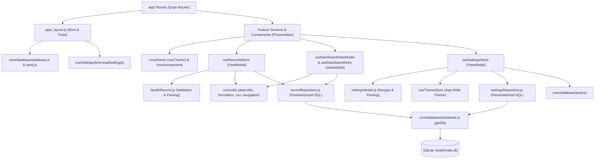

# HealthMate — Application Architecture

HealthMate is an offline-first mobile and web health tracking application built with **Expo SDK 58**, **React Native**, **Expo Router**, **Zustand**, and **SQLite** (`expo-sqlite`). The codebase follows a **Feature-Based MVVM (Model-View-ViewModel)** architecture paired with a strict **Repository Layer** so that SQL queries never appear in screens or ViewModels, and UI components remain purely presentational.

---

## 1. Architectural Layers

| Layer | Location | Responsibility | Allowed Dependencies |
| :--- | :--- | :--- | :--- |
| **Routing (`app/`)** | `app/_layout.js`, `app/(tabs)/*`, `app/record-form.js` | Expo Router layouts, startup DB/settings hydration, global `<Toast />` mounting, and thin route wrappers returning feature screens. | Feature Screens, `core/database` (startup boot only), `core/theme`, `core/components`, `settings/viewmodel` |
| **Presentation (Views)** | `src/features/*/screens/`, `src/features/*/components/`, `src/core/components/` | Pure UI rendering, accessibility labels, animations (`Animated`), user gestures, and calling ViewModel actions. Zero business calculations or SQL. | Feature ViewModels, `core/theme`, `core/components`, `core/utils`, Model hints/constants |
| **ViewModel (State & Orchestration)** | `src/features/*/viewmodel/` | Zustand stores and derived React hooks (`useDashboardViewModel`, `useRecordsStore`, `useSettingsStore`). Orchestrates validation, CSV export, comparisons, streaks, 7-day summaries, and optimistic/safe mutations. | Feature Models, Feature Repositories, `core/utils`, `core/theme` (metrics/theme store), sibling ViewModels |
| **Model (Domain & Validation)** | `src/features/*/model/` | Pure entities, data shapes (`createHealthRecord`, `toHealthRecord`), sensible bounds (`LIMITS`, `GOAL_RANGES`), and deterministic validation (`validateRecord`, `validateDailyGoals`). Zero React, Zustand, or SQLite imports. | `core/utils`, `core/theme/metrics` |
| **Repository (Persistence)** | `src/features/*/repository/` | Sole layer executing parameterized SQLite statements (`?` placeholders) via `getDb()` imported directly from `core/database/database.js`. | `src/core/database/database.js` |
| **Core Infrastructure** | `src/core/` | Shared database singleton (`initDatabase`, `getDb`, `seedDatabase`), design-system tokens & `useTheme`, reusable accessible UI components, and pure helpers (`dateUtils`, `formatters`, `csv`, `navigation`). | Expo / React Native primitives |

---

## 2. Folder Structure

```text
healthmate/
├── app/                                 # Expo Router file-based routes
│   ├── _layout.js                       # Root Stack: boots DB + seeds + loads settings, mounts <Toast />
│   ├── record-form.js                   # Modal route (/record-form) wrapping RecordFormScreen
│   └── (tabs)/                          # Bottom-tab route group
│       ├── _layout.js                   # 3-tab layout (Home, History, Settings)
│       ├── index.js                     # Home tab -> DashboardScreen
│       ├── history.js                   # History tab -> HistoryScreen
│       └── settings.js                  # Settings tab -> SettingsScreen
├── src/
│   ├── core/
│   │   ├── components/                  # Design-system UI primitives & animation wrappers
│   │   │   ├── AppButton.js             # Primary / secondary / text / destructive buttons (48dp target)
│   │   │   ├── AppCard.js               # Standard rounded (20dp) elevated surface card
│   │   │   ├── AppText.js               # Typography-variant text bound to active theme
│   │   │   ├── AppTextInput.js          # Accessible labeled input with icon, unit & error state
│   │   │   ├── EmptyState.js            # Friendly empty view with optional CTA button
│   │   │   ├── FadeInView.js            # 220ms calm fade/slide settle wrapper for list rows
│   │   │   ├── FloatingActionButton.js  # Bottom-right 56dp "+" action button
│   │   │   ├── MetricCard.js            # Color-coded metric summary + "vs yesterday" badge
│   │   │   ├── PressableScale.js        # 150ms scale feedback wrapper
│   │   │   ├── ProgressRing.js          # SVG circular ring animated via state + Animated.Value
│   │   │   ├── QuickChip.js             # +1000 / +2500 / +50 / +100 / +250 / +500 quick-add chips
│   │   │   ├── ScreenContainer.js       # Safe-area wrapper with max-width 720dp responsive scroll
│   │   │   ├── StatusStates.js          # Centered LoadingState & ErrorState with retry
│   │   │   ├── Toast.js                 # Global Snackbar (`useToastStore`, `showSuccessToast`, `showErrorToast`)
│   │   │   └── index.js
│   │   ├── database/
│   │   │   ├── database.js              # `initDatabase()`, `getDb()`, SQLite PRAGMAs & schema v1 migration
│   │   │   ├── seed.js                  # `seedDatabase(force)` seeding 11 entries over 10 local days
│   │   │   └── index.js
│   │   ├── theme/
│   │   │   ├── colors.js                # `lightColors` and `darkColors` palettes
│   │   │   ├── metrics.js               # `METRICS` & `METRIC_KEYS` (icons, units, goals, limits)
│   │   │   ├── shadows.js               # Soft & elevated light/dark shadows
│   │   │   ├── spacing.js               # 8-pt spacing scale, radii (`card: 20`, `button: 14`), `TOUCH_TARGET.min: 48`
│   │   │   ├── typography.js            # Material-inspired type scale (`display` through `metricNumber`)
│   │   │   └── index.js                 # `useTheme()` hook & `useThemeStore` theme override store
│   │   └── utils/
│   │       ├── csv.js                   # Pure RFC 4180 CSV serializer (`recordsToCsv`)
│   │       ├── dateUtils.js             # Timezone-safe YYYY-MM-DD calendar date helpers
│   │       ├── formatters.js            # Number formatting, time greetings, clamped percent calc
│   │       ├── navigation.js            # `safeGoBack` (canGoBack guard) & `safePush` (400ms cooldown)
│   │       └── index.js
│   └── features/
│       ├── dashboard/
│       │   ├── components/              # HeroProgressCard, StreakBannerCard, WeeklySummaryCard
│       │   ├── screens/                 # DashboardScreen.js
│       │   └── viewmodel/               # useDashboardViewModel.js (`useDashboardStore` + derivation helpers)
│       ├── history/
│       │   ├── components/              # HistoryToolbar, DateSearchBar, DateRangeModal, SortMenuModal, HistoryRecordCard, ConfirmDeleteModal
│       │   └── screens/                 # HistoryScreen.js
│       ├── records/
│       │   ├── model/                   # healthRecord.js (`LIMITS`, `validateRecord`, `toHealthRecord`)
│       │   ├── repository/              # recordRepository.js (all SQLite CRUD & summary queries)
│       │   ├── screens/                 # RecordFormScreen.js (Add / Edit modal UI)
│       │   └── viewmodel/               # useRecordsStore.js (CRUD, filtering, sorting, CSV export)
│       └── settings/
│           ├── components/              # ThemeSegmentedControl.js
│           ├── model/                   # settingsModel.js (keys, ranges, `validateDailyGoals`)
│           ├── repository/              # settingsRepository.js (`getSetting`, `setSetting`, `setSettingsBatch`, `getAllSettings`)
│           ├── screens/                 # SettingsScreen.js
│           └── viewmodel/               # useSettingsStore.js (goals, theme mode, sample-data seeding)
├── __tests__/                           # Jest + jest-expo automated unit test suites
└── docs/                                # Architecture, database, design system, and QA documentation
```

---

## 3. Architecture Diagram



---

## 4. Data Flow & State Management

### Startup Sequence
1. `app/_layout.js` executes `initDatabase()` to open `healthmate.db`, apply `PRAGMA journal_mode = WAL` and `PRAGMA foreign_keys = ON`, and migrate schema to `PRAGMA user_version = 1`.
2. `seedDatabase()` checks `SELECT COUNT(*) FROM health_records` and populates 11 entries across the last 10 days only when the table is empty.
3. `useSettingsStore.getState().loadSettings()` reads stored keys from the `settings` table, validates/parses daily targets, and updates `useThemeStore` immediately so the entire app boots in the saved theme (`system`, `light`, or `dark`).
4. Once `isDbReady` becomes `true`, the `<Stack>` navigator mounts `(tabs)` and the `record-form` modal alongside the global `<Toast />` overlay.

### Read, Write, and Reactive Refresh Flow
- **Adding / Editing a Record:** `RecordFormScreen` collects raw strings and calls `useRecordsStore.addRecord()` or `editRecord()`. The ViewModel guards against rapid double-submits (`lastSaveStatus === 'saving'`), runs `validateRecord()` from `healthRecord.js`, converts inputs with `toHealthRecord()`, persists via `recordRepository.js`, and immediately awaits `[loadRecords(), loadTodayTotals()]`.
- **Dashboard Synchronization:** `useDashboardViewModel` subscribes to `useRecordsStore` (`records`, `todayTotals`), `useSettingsStore` (`dailyGoals`), and `useDashboardStore`. Whenever records change or the Dashboard regains focus (`useFocusEffect`), `loadDashboard` fetches today/yesterday totals, `getTotalsBetween` for the 7-day chart, and `getDistinctRecordDates` for streak computation in a single `Promise.all` batch.
- **History Filtering, Sorting & Export:** `HistoryScreen` reads `records`, `searchDate`, `rangeStart`, `rangeEnd`, and `sortOrder` from `useRecordsStore` using primitive selectors (preventing Zustand v5 unstable-object snapshot loops). Pure filtering/sorting runs through `selectFilteredRecords()`, and `exportCsv()` serializes the currently visible list via `recordsToCsv()`.

### Why Zustand?
- **Fine-grained selector subscriptions:** Components subscribe to specific slices (`state => state.todayTotals`, `state => state.themeMode`), avoiding full-tree re-renders triggered by Context updates.
- **Provider-free global access:** Stores such as `useSettingsStore`, `useThemeStore`, and `useToastStore` work both as React hooks and outside React components via `.getState()` (used in `app/_layout.js`, event handlers, and theme rollbacks).
- **Concurrency & rollback guards:** `useSettingsStore.setThemeMode()` tracks `latestThemeRequestId` so rapid taps never overwrite newer theme choices on slow SQLite failures, and `useRecordsStore` locks concurrent saves (`lastSaveStatus === 'saving'`) and concurrent exports (`isExporting`).
