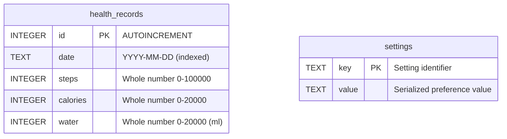

# HealthMate — Database Schema & Persistence Design

HealthMate stores all user health logs and preferences locally on-device using **`expo-sqlite`**. No external API or cloud storage is used. Every SQL query lives exclusively inside `src/features/*/repository/` or `src/core/database/` and uses `?` parameter placeholders to prevent SQL injection.

---

## 1. Database Initialization & Connection

- **Database File:** `healthmate.db` (`src/core/database/database.js`)
- **Engine Configuration:**
  - `PRAGMA journal_mode = WAL;` — Write-Ahead Logging for safer concurrent reads/writes.
  - `PRAGMA foreign_keys = ON;` — Enforces referential integrity across schema versions.
  - `PRAGMA user_version = 1;` — Tracks idempotent schema migrations during startup.
- **Singleton & Lock:** `initDatabase()` caches both an active `dbInstance` singleton and an in-flight `initPromise` so overlapping callers reuse the same connection rather than opening duplicate handles. On error, `initPromise` resets to `null` so the UI Retry button can re-attempt initialization cleanly.
- **Web Support (`metro.config.js`):** Extends `resolver.assetExts` with `'wasm'` so `expo-sqlite`'s web worker resolves `wa-sqlite.wasm` in browser environments.

---

## 2. Schema & Entity-Relationship Diagram

`healthmate.db` defines two independent tables: transactional daily activity logs (`health_records`) and a persistent key-value preferences store (`settings`).



### Table 1: `health_records`

```sql
CREATE TABLE IF NOT EXISTS health_records (
  id INTEGER PRIMARY KEY AUTOINCREMENT,
  date TEXT NOT NULL,
  steps INTEGER NOT NULL,
  calories INTEGER NOT NULL,
  water INTEGER NOT NULL
);

CREATE INDEX IF NOT EXISTS idx_health_records_date ON health_records(date);
```

| Column | SQLite Type | Constraints | Description |
| :--- | :--- | :--- | :--- |
| `id` | `INTEGER` | `PRIMARY KEY AUTOINCREMENT` | Unique row identifier assigned by SQLite on insert. |
| `date` | `TEXT` | `NOT NULL` | Local calendar date formatted strictly as `YYYY-MM-DD` (indexed via `idx_health_records_date`). |
| `steps` | `INTEGER` | `NOT NULL` | Logged step count (validated domain range: `0` – `100,000`). |
| `calories` | `INTEGER` | `NOT NULL` | Active calories burned in kcal (validated domain range: `0` – `20,000`). |
| `water` | `INTEGER` | `NOT NULL` | Hydration intake in millilitres (`ml`) (validated domain range: `0` – `20,000`). |

*Note: Multiple `health_records` rows can share the same `date` (e.g., morning and evening logs on the same day). The Dashboard aggregates all rows matching a date using `SUM(...)`.*

### Table 2: `settings`

```sql
CREATE TABLE IF NOT EXISTS settings (
  key TEXT PRIMARY KEY,
  value TEXT NOT NULL
);
```

| Column | SQLite Type | Constraints | Description |
| :--- | :--- | :--- | :--- |
| `key` | `TEXT` | `PRIMARY KEY` | Setting key identifier. |
| `value` | `TEXT` | `NOT NULL` | Serialized string representation of the preference. |

**Stored Setting Keys (`src/features/settings/model/settingsModel.js`):**

| Key | Default Value | Valid Range / Values | Purpose |
| :--- | :--- | :--- | :--- |
| `goal_steps` | `'10000'` | Integer string `500` – `50,000` | Custom daily step goal for Dashboard rings. |
| `goal_calories` | `'500'` | Integer string `100` – `5,000` | Custom daily active calorie goal (`kcal`). |
| `goal_water` | `'2000'` | Integer string `500` – `6,000` | Custom daily water goal (`ml`). |
| `theme_mode` | `'system'` | `'system'` \| `'light'` \| `'dark'` | App-wide appearance mode override. |

---

## 3. Initial Seeding (`src/core/database/seed.js`)

On initial launch (`seedDatabase(force = false)`), SQLite checks:

```sql
SELECT COUNT(*) AS count FROM health_records;
```

If `count === 0` (or when the user triggers **Restore Sample Records** in Settings with `force = true`), `seedDatabase` runs `db.withTransactionAsync(...)` to atomically insert **11 realistic entries spanning the last 10 local calendar days** (including two separate entries on day index 5 to demonstrate multi-entry daily aggregation).

---

## 4. Repository Pattern & Direct Connection Imports

To guarantee **zero require cycles** between `src/core/database/index.js` and feature repositories:
- Repositories (`recordRepository.js`, `settingsRepository.js`) import `getDb` directly from `'../../../core/database/database'` rather than the barrel `'../../../core/database'`.
- ViewModels (`useRecordsStore`, `useDashboardStore`, `useSettingsStore`) are the only callers of repositories.
- Screens and UI components never import SQLite or repositories directly.

---

## 5. Sample Parameterized SQL Used in Production

### Create Record (`recordRepository.js`)
```sql
INSERT INTO health_records (date, steps, calories, water)
VALUES (?, ?, ?, ?);
```

### Read Newest-First / By ID / By Date / Date Range (`recordRepository.js`)
```sql
-- All records
SELECT id, date, steps, calories, water
FROM health_records
ORDER BY date DESC, id DESC;

-- Single record (Edit prefill fallback)
SELECT id, date, steps, calories, water
FROM health_records
WHERE id = ?;

-- Single calendar date filter
SELECT id, date, steps, calories, water
FROM health_records
WHERE date = ?
ORDER BY id DESC;

-- Inclusive From/To range filter
SELECT id, date, steps, calories, water
FROM health_records
WHERE date BETWEEN ? AND ?
ORDER BY date DESC, id DESC;
```

### Update & Delete Record (`recordRepository.js`)
```sql
UPDATE health_records
SET date = ?, steps = ?, calories = ?, water = ?
WHERE id = ?;

DELETE FROM health_records
WHERE id = ?;
```

### Dashboard Aggregations & Streak Query (`recordRepository.js`)
```sql
-- Single-day metric totals (Today / Yesterday)
SELECT
  COALESCE(SUM(steps), 0) AS steps,
  COALESCE(SUM(calories), 0) AS calories,
  COALESCE(SUM(water), 0) AS water
FROM health_records
WHERE date = ?;

-- 7-day grouped totals for the Dashboard bar chart
SELECT
  date,
  COALESCE(SUM(steps), 0) AS steps,
  COALESCE(SUM(calories), 0) AS calories,
  COALESCE(SUM(water), 0) AS water
FROM health_records
WHERE date BETWEEN ? AND ?
GROUP BY date
ORDER BY date ASC;

-- Distinct logged dates sorted newest-first for consecutive streak math
SELECT DISTINCT date
FROM health_records
WHERE date <= ?
ORDER BY date DESC;
```

### Settings Upsert & Read All (`settingsRepository.js`)
```sql
SELECT value FROM settings WHERE key = ?;

INSERT OR REPLACE INTO settings (key, value)
VALUES (?, ?);

SELECT key, value FROM settings;
```
